**Full-Stack AI Engineer** · LLM agents · tool calling · RAG · voice AI · TypeScript · Next.js · Node.js · Python · PostgreSQL · Claude Code 
India · remote, any time zone · contractor or employer of record

## Hi, I'm Adel 👋

I'm a full-stack AI engineer. I build production LLM agents and the apps around them, where an agent does real work on real data: books expenses, runs a shop's stock, joins a meeting and talks. I build them with **Claude Code**. I direct it, I read what it writes, and I test everything before it ships.

What I like most is taking things that were never meant to go together and turning them into something new.

## How I got here

I started in medical school. I was always a creative person, but I wasn't happy, and it took me a while to work out why. When I traced it back to my childhood, the answer was simple: I'm happiest when I'm making things.

During COVID I taught myself some Python and started building small tools for my medical studies. That was the turning point. I made the biggest decision of my life, went against what my family expected, and moved into technology and AI.

AI changes every week, so there's always a new problem to figure out. That's the creativity I was looking for.

## What I've built

| | Project | What it is | |
|---|---|---|---|
| 🏢 | **[Future Office](https://github.com/bumblebees002/future-office-showcase)** | A real-time spatial workspace: live office map, knock-to-talk, meetings, whiteboards and in-office AI agents you can talk to. Live, with my own team using it every day. | [Live](https://future-office.auralynxai.com) · [Demo](https://www.loom.com/share/fb8d93ce6177413fbe70dbec5c71d926) |
| 💸 | **[AI Accountant](https://github.com/bumblebees002/ai-accountant-showcase)** | Multi-tenant finance SaaS with one assistant over web, Telegram, WhatsApp and voice. Reads receipts and sends unpaid invoices to a person for approval. | [Live](https://accountant.auralynxai.com) · [Demo](https://www.loom.com/share/d40cf416464742e6aef182397a284e94) |
| 🛒 | **[AI Shopkeeper](https://github.com/bumblebees002/ai-shopkeeper-showcase)** | Chat-first stock, sales and profit for a small shop. Type "2 coke, 1 bread" and it updates stock and books the profit, after you confirm. | Demo soon |
| 🦞 | **[HostClaw](https://github.com/bumblebees002/hostclaw-showcase)** | One-click hosting for OpenClaw agents. Started from the open-source ClawHost project. | [Live](https://hostclaw.cloud) |
| 🧰 | **[Claude Code workflow](https://github.com/bumblebees002/claude-code-workflow)** | My own skills and commands: `/phases` (parallel worktrees + one verification gate), `compact-prompt`, `template`, `proposal` and more. | [Repo](https://github.com/bumblebees002/claude-code-workflow) |

> The product code is private. Each showcase repo explains how it works, and I'm happy to walk through the real code in a call.

## How I work

- **Agents propose, people approve.** Anything that writes money or stock waits for a human yes.
- **Tenants never see each other's data.** Every query is scoped to one customer.
- **Tests prove the guard works,** not just that the happy path runs.
- **Every project has a memory.** Decisions and lessons live in my Obsidian vault, so the next session starts smarter.

## Tools I reach for

**AI:** Claude Code · LLM agents with tool calling · RAG with pgvector · n8n
**Voice:** LiveKit · Deepgram · VAPI · ElevenLabs · Retell
**Infra:** Fastify · Traefik · two production VPS boxes · Composio · Stripe

Always building something. If you're hiring for AI or full-stack work, I'd love to talk.

